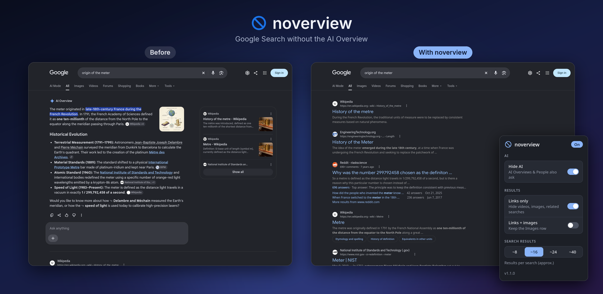

<p align="center">
  
</p>

<h1 align="center">noverview</h1>

<p align="center">
  A Firefox extension that hides Google's AI Overviews and leaves you with links to websites.
</p>

<p align="center">
  <a href="https://addons.mozilla.org/en-US/firefox/addon/google-ai-overview-purger/">Firefox add-on</a>
  · <a href="PRIVACY.md">Privacy</a>
  · <a href="LICENSE.md">MPL-2.0</a>
</p>

<p align="center">
  
</p>

> **Chrome is not supported yet.** Use Firefox 121 or later.

## Features

* Hides the AI Overview at the top of Google Search, and the People also ask box, whose answers are AI-generated.
* **Links only** hides videos, short videos, images, People also search for and the side panel, so only web results are left. Answer cards such as the calculator, currency and unit converters and weather stay. **Links + images** does the same but keeps the Images row.
* **Search results** loads more results onto one page (about 8, 16, 24 or 40) by fetching Google's next results pages in the background.
* If Google rate-limits those extra pages, the extension stops, pauses for 30 minutes and lowers the maximum for the next 24 hours. The popup shows the limit and has a Reset link.
* Nothing is deleted from the page. Turning a setting off brings the hidden parts back straight away.

## Installation

### Firefox (add-ons store)

The listing is pending review by Mozilla. Once approved, install it from https://addons.mozilla.org/en-US/firefox/addon/google-ai-overview-purger/

### Firefox (manual)

1. Go to `about:addons`
2. Click the gear icon, then **Install Add-on From File**
3. Select the packaged `.zip`

On first use, Firefox may ask you to allow access to Google Search. Click **Allow access** in the popup, or turn it on under `about:addons` → noverview → **Permissions**.

### Chrome

Not on the Chrome Web Store and untested. The steps below are for development only:

1. Clone this repository:

   ```bash
   git clone https://github.com/cli-geek/noverview.git
   ```
2. Open `chrome://extensions/`
3. Enable **Developer mode**
4. Click **Load unpacked**
5. Select the project folder

## How it works

A content script runs on `www.google.com/search` pages. A stylesheet loaded with the page hides the blocks it can match by attribute before they are drawn. The script finds the rest as they load, including any heading that reads "AI Overview", and marks them hidden.

When **Search results** is above about 8, the script requests Google's next results pages one at a time, 750 ms apart. It keeps only the web results, removes scripts from them and adds them below page 1. The Images row is only ever shown from page 1.

## Privacy

The extension does not collect data or send anything to its author or any third party. The only requests it makes are to Google: when **Search results** is above about 8, it fetches Google's next results pages for the search you made, from your browser. See [PRIVACY.md](PRIVACY.md).

## Development

### Project structure

```
.
├── manifest.json
├── content.js          # hides AI and non-link blocks
├── content.css         # hiding rules, loaded before first paint
├── more.js             # fetches and appends extra results pages
├── popup.html
├── popup.js
├── browser-polyfill.js
└── icons/              # icon.svg is the source for the PNGs
```

To try a change, open `about:debugging#/runtime/this-firefox`, click **Load Temporary Add-on** and pick `manifest.json`. Click **Reload** there after each edit.

## Roadmap

* Chrome support
* Google country domains (google.co.uk, google.de and others); only google.com is matched now

## License

Mozilla Public License 2.0.

## AI usage attestation

This program and its documentation were created with AI assistance.

Requirements specified at the discretion of cli-geek.

Output reviewed and verified.

## Support

If you find this useful, consider starring the repo.
